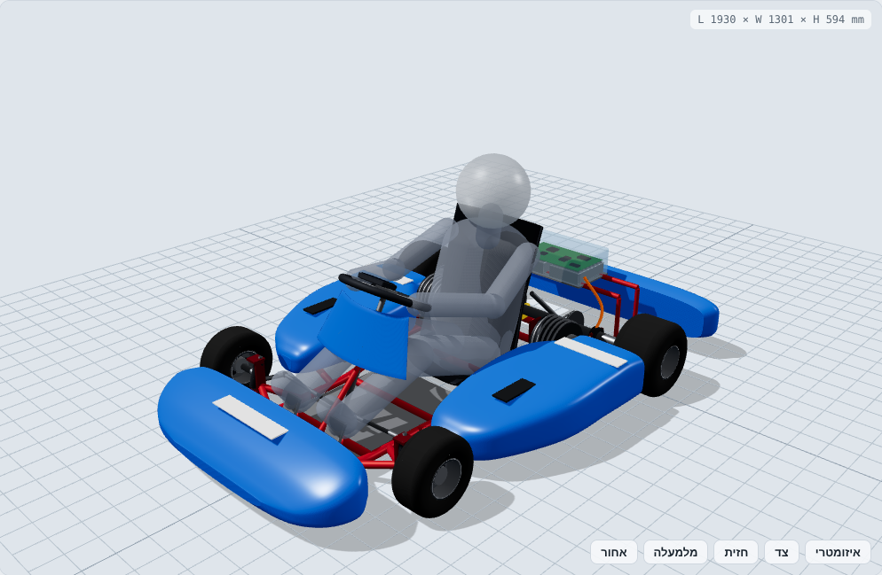
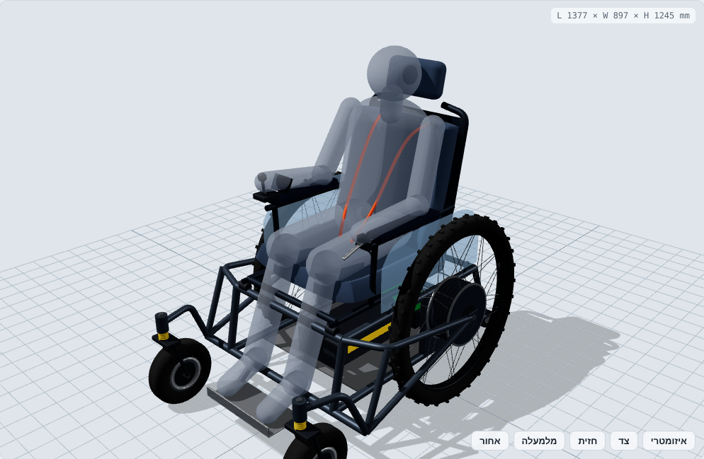

# קארט חשמלי וכיסא גלגלים מהיר: מודלים תלת-ממדיים

מודלי קונספט פרמטריים לשני כלי רכב חשמליים:

| | |
|---|---|
|  |  |
| **[קארט חשמלי בינוני](docs/gokart.md)**: שלדת כרום-מולי, כיסוי אווירודינמי, 2 מנועים של 72V, סוללות בתאים הצדדיים, לוח בקרה מאחורי המושב והיגוי אקרמן | **[כיסא גלגלים חשמלי מהיר](docs/wheelchair.md)**: גלגלי 29 בסגנון אופני הרים עם מנועי רכזת, בלמי דיסק Ø203, מושב על מתלה ושלדה רחבה ויציבה |

## מספרים עיקריים

| | קארט | כיסא גלגלים |
|---|---|---|
| מידות (א×ר×ג) | 1930 × 1300 × 594 מ"מ | 1377 × 897 × 1245 מ"מ |
| משקל ריק / עם נהג | ~92 / ~172 ק"ג | ~65 / ~150 ק"ג |
| מנועים | 2 × 72V PMSM, 5 kW רציף / 12 kW שיא | 2 × מנוע רכזת DD 72V, 2 kW / 4 kW |
| סוללה | 72V 36Ah (2.6 kWh) | 72V 27Ah (1.94 kWh) |
| מהירות מרבית | ~91 קמ"ש | 40 קמ"ש (מוגבלת בתוכנה) |
| בלמים | דיסק Ø180 אחורי + רגנרציה | 2 × דיסק הידראולי Ø203 + רגנרציה |

## מבנה המאגר

```
index.html            צופה תלת-ממדי אינטראקטיבי (three.js): הצגה והסתרה של חלקים, זוויות מבט, שקיפות
models/lib/parts.js   פונקציות גיאומטריה: צינור מכופף, loft, משטח עבה, חישוק, דיסק בלם, קפיץ
models/gokart.js      מודל הקארט: כל המידות בקבוע KART בראש הקובץ
models/wheelchair.js  מודל הכיסא: כל המידות בקבוע CHAIR בראש הקובץ
scripts/export.mjs    מייצא STL לכל חלק ו-GLB להרכבה המלאה לתיקייה exports/
scripts/calc.mjs      חישובי משקל, מרכז כובד, הספק, תאוצה, יציבות וטווח
scripts/render.mjs    מייצר את תמונות התצוגה ב-docs/img/
exports/              קבצי STL (מ"מ, Z למעלה) ו-GLB (מטר, Y למעלה)
docs/                 תיעוד תכנון לכל כלי
```

## הרצה

```bash
npm install
npm run export     # STL + GLB
npm run calc       # חישובים הנדסיים
npm run serve      # ואז לפתוח http://localhost:8080 לצפייה בתלת-ממד
```

כדי לשנות מידה (בסיס גלגלים, מיקום סוללה, קוטר צינור וכו') עורכים את הקבוע בראש קובץ המודל ומריצים שוב `npm run export`.

### ייבוא ל-CAD

- **STL:** כל חלק בקובץ נפרד. נפתח ב-Fusion 360, SolidWorks, FreeCAD, Blender, או בתוכנת פריסה להדפסה.
- **GLB:** ההרכבה המלאה בצבע. נפתח ב-Windows 3D Viewer, ב-Blender, או בצופה של GitHub.
- **מגבלה:** אלה מודלי קונספט למיקום, מידות והחלטות תכנון, לא שרטוטי ייצור. הצינורות מיוצגים כמוטות מלאים, ולפני ייצור צריך לבנות מחדש בתוכנת CAD פרמטרית ולבצע ניתוח חוזק (FEA).

## אזהרה

המספרים בתיעוד הם הערכות תכנון ראשוניות, מסימולציה פשוטה (`scripts/calc.mjs`). כלי רכב חשמלי ב-72V, במהירויות האלה, דורש ניתוח חוזק, תכנון מערכת מתח גבוה (נתיכים, מנתק חירום, BMS) ובדיקות מבוקרות לפני נסיעה. עם קסדה.
