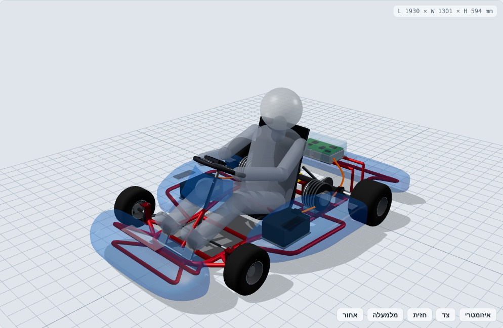

# קארט חשמלי בינוני: שלדה, כיסוי ומערכות

מודל: `models/gokart.js` · קבצי STL: `exports/gokart/` · חישובים: `npm run calc`

מערכת צירים בכל המודלים: מ"מ, X קדימה (0 = קו הסרן האחורי), Y שמאלה, Z למעלה (0 = הקרקע).

## מידות עיקריות

| פרמטר | ערך |
|---|---|
| מידות חיצוניות (ללא נהג) | 1930 × 1300 × 594 מ"מ |
| בסיס גלגלים | 1050 מ"מ |
| מפשק (מרכז גלגל) | 980 קדמי / 1120 אחורי |
| גלגלים | 10×4.50-5 קדמי, 11×7.10-5 אחורי |
| מרווח מהקרקע | ~40 מ"מ (צינור השלדה בגובה 55) |
| משקל | ~92 ק"ג ריק, ~172 ק"ג עם נהג 80 ק"ג |
| חלוקת משקל | 38% קדמי / 62% אחורי |
| מרכז כובד | 401 מ"מ לפני הסרן האחורי, גובה 229 מ"מ |

## שלדה

- **חומר:** צינור כרום-מולי 4130 בקוטר 30 מ"מ ודופן 2 מ"מ. הצינורות המשניים בקוטר 25.
- **מסגרת היקפית רציפה:** צינור אחד מכופף שמתחיל מאחור משמאל, מסתובב סביב האף וחוזר אחורה מימין. השלדה רחבה מאחור (±330) וצרה בחלק הקדמי (±220), כדי שיהיה מקום לרגליים ולהיגוי.
- **צינורות רוחב:** בגבול האחורי, ליד הסרן (נושא את המיסב המרכזי), שניים מתחת למושב, אחד ברצפה ואחד בציר הסרן הקדמי.
- **זרועות למוט ההיגוי (kingpin):** משולש בכל צד ותושבת C עם לוחות עליון ותחתון.
- **פסי צד (nerf bars):** נושאים את התאים הצדדיים ומגינים על חבילות הסוללה במגע צד.
- **פגוש קדמי:** שתי לולאות בתוך האף.
- **מסגרת אחורית:** פגוש, ועמודים שנושאים את מגש האלקטרוניקה.
- **רצפה:** פח אלומיניום 4 מ"מ מתחת לרגלי הנהג.
- **תושבות מנוע:** לוחות על המסגרת הראשית משני צדי המושב, כמו תושבת מנוע בקארט בנזין.

הקארט בנוי בלי מתלים ובלי דיפרנציאל, כמו כל קארט. הגמישות של השלדה והגיאומטריה של ההיגוי מרימות את הגלגל האחורי הפנימי בפנייה. לכן קוטר הצינור ועובי הדופן הם "כפתור כוונון": צינור דק יותר נותן שלדה רכה יותר ואחיזה טובה יותר על משטח חלק.

## מנועים והנעה

- **2 מנועי PMSM/BLDC של 72V,** כל אחד 5 kW רציף ו-12 kW שיא, ~45 Nm, מהירות מרבית ~5000 סל"ד. זה המעמד של QS138 / HPM-5000. לפני רכישה צריך לבדוק את המספרים מול גיליון הנתונים.
- **מיקום:** משני צדי המושב, לפני הסרן (x=200). במיקום הראשון שבדקתי, מאחורי הסרן, חלוקת המשקל יצאה 29/71. זה כבד מדי מאחור, וגורם לתת-היגוי וחוסר יציבות. לפני הסרן היא 38/62, בטווח הרגיל לקארט.
- **העברה:** שרשרת ‎#219, גלגל שיניים 11T על המנוע ו-32T על הסרן (2.91:1). שני המנועים מושכים את אותו סרן חי בקוטר 40 מ"מ, דרך שני גלגלי שיניים.
- **ביצועים:** מהירות מרבית ~91 קמ"ש (מוגבלת ע"י ההעברה). 0–60 קמ"ש ב-~2.0 ש' בסימולציה. זה זמן תיאורטי, מוגבל ע"י אחיזה של ~0.9g. כדי לשנות את האיזון בין תאוצה למהירות מחליפים את גלגל השיניים האחורי.
- **בלמים:** דיסק אחורי מאוורר Ø180 עם קליפר 4 בוכנות, ובנוסף בלימה רגנרטיבית מהבקרים (טוענת את הסוללה).

## סוללה

- **2 חבילות 10S8P בתאי 21700** (למשל Molicel P45B), מחוברות בטור: 72V נומינלי, 36Ah, 2.6 kWh.
- **זרם:** בהספק שיא של 2×12 kW הסוללה מספקת 333A. החבילה מדורגת ל-360A רציף.
- **מיקום:** כל חבילה (240×170×110 מ"מ, ~7.5 ק"ג) יושבת על מגש בתוך התא הצדדי. המסה נמוכה ובין הסרנים, ובאוויר שנכנס מפתח האוויר בגג התא.
- **זמן נסיעה:** ~19 דק' בקצב מירוץ (~8 kW ממוצע), ~50 דק' בנסיעת פנאי (~3 kW).

## לוח בקרה ואלקטרוניקה

- **מיקום:** תיבה של 200×340×100 מ"מ מאחורי המושב, מעל הסרן, עם מכסה פוליקרבונט.
- **תכולה:** 2 בקרי FOC (אחד לכל מנוע) עם צלעות קירור. לוח ראשי (VCU) שמחבר בין המצערת, הבלם והבקרים. BMS ראשי, מגען ראשי, וממיר DC-DC ל-12V.
- **למה שם:** כבלי המתח הגבוה (בכתום במודל) קצרים, התיבה מוגנת מפגיעה ומקבלת אוויר.
- **צג:** 4.3" על רכזת ההגה, שמציג מהירות, מצב סוללה, טמפרטורות ותקלות.

## היגוי

- **אקרמן:** זרועות ההיגוי (100 מ"מ) מכוונות למרכז הסרן האחורי, בזווית 19.4°. כך בפנייה לשני הגלגלים הקדמיים יש מרכז סיבוב משותף.
- **קסטור 12° ו-KPI 10°:** מחזירים את ההגה למרכז. בפנייה הם מרימים את הצד הפנימי של השלדה, וזה מה שמאפשר לקארט עם סרן חי לפנות.
- **מוט היגוי ישיר (1:1):** הגה בקוטר 300 מ"מ ותמיכה אחת בין הרגליים. ממנו יוצאים מוטות קישור ללוחית בתחתית המוט.
- **דוושות:** בלם משמאל, מצערת (חיישן Hall) מימין.

## אווירודינמיקה

במהירויות של קארט רוב הגרר בא מהנהג ומהגלגלים החשופים. מטרת הכיסוי היא לסגור את השטחים המופרעים בלי להעלות את משקל הקארט ואת מרכז הכובד שלו.

| רכיב | תפקיד |
|---|---|
| אף נמוך ורחב (930 מ"מ) | מסתיר ~70% מפני הגלגלים הקדמיים, בעל שפה עגולה ומשטח עליון שמשתפע כלפי מעלה |
| לוח מחוונים קדמי | מעל השוקיים. מטה את הזרימה מעל הידיים והגוף |
| תאים צדדיים | סוגרים את הרווח בין הגלגלים. החלק האחורי צר כדי לפנות מקום למנוע ומכסה את חזית הגלגל האחורי |
| פתחי אוויר בגג התאים | מקררים את הסוללה |
| פגוש אחורי | סוגר את השובל שמאחורי הגלגלים האחוריים ומגן על המנועים |
| תחתית חלקה | פח הרצפה ותחתית התאים |

**הערכה:** CdA ≈ 0.45 מ"ר עם הכיסוי, לעומת ~0.55 לקארט פתוח. ב-90 קמ"ש ההספק הנדרש יורד מ-6.4 ל-5.4 kW. בפועל המספרים צריכים אימות ב-CFD או בבדיקת דעיכה (coast-down).

## צעדים הבאים

1. ניתוח אלמנטים סופיים (FEA) לשלדה: פגיעה חזיתית וצידית, ונקודות התושבות.
2. בחירת מנועים ובקרים סופיים, ועדכון `KART.motor` ויחס ההעברה.
3. תכנון BMS ומארז סוללה (IP65, נתיך ראשי, מנתק חירום).
4. ייצור הכיסוי מפיברגלס או ABS בתבנית. קובץ `body.stl` יכול לשמש כבסיס.
