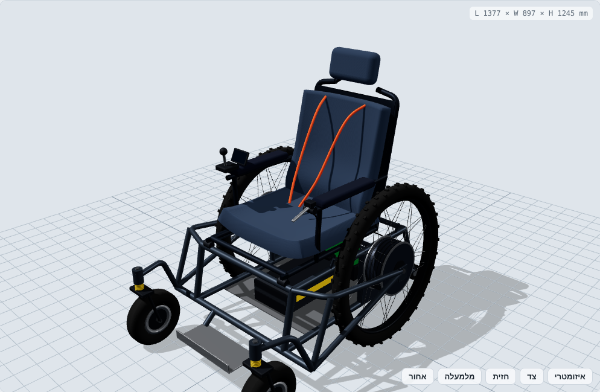

# כיסא גלגלים חשמלי מהיר עם גלגלי 29

מודל: `models/wheelchair.js` · קבצי STL: `exports/wheelchair/` · חישובים: `npm run calc`

זה כלי ספורט ושטח, לא כיסא רפואי. לכן המנועים והסוללה גדולים, אין מגבלת רוחב של דלת, ומהירות היעד היא 40 קמ"ש.

מערכת צירים: מ"מ, X קדימה (0 = ציר הגלגלים הגדולים), Y שמאלה, Z למעלה.

## מידות עיקריות

| פרמטר | ערך |
|---|---|
| מידות חיצוניות | 1377 × 897 × 1245 מ"מ |
| מפשק | 756 מ"מ אחורי (כולל קמבר 2°), 740 קדמי |
| בסיס גלגלים | 745 מ"מ (ציר הגלגל הגדול → מגע גלגל ההיגוי) |
| גובה מושב | ~560 מ"מ (פני הכרית) |
| משקל | ~65 ק"ג ריק, ~150 ק"ג עם רוכב 85 ק"ג |
| מרכז כובד | 119 מ"מ לפני הציר, גובה 585 מ"מ |

## גלגלי 29 ובלמי דיסק

- **חישוק:** ‎29" (ETRTO 622, רוחב פנימי 30 מ"מ).
- **צמיג:** 29×2.4 עם שיני שטח. בלחץ נמוך הוא בולע רעידות.
- **מנוע רכזת DD בכל גלגל:** 72V, ‏2 kW רציף ו-4 kW שיא, ~100 Nm. ב-40 קמ"ש הגלגל מסתובב 286 סל"ד, בתחום היעיל של מנוע כזה. אין שרשרת, אין תמסורת ואין רעש.
- **36 חישורים בשזירת 1-cross:** במנוע רכזת האוגן רחב, ולכן החישורים קצרים ושזירה פשוטה מתאימה.
- **בלם:** דיסק Ø203 בצד הפנימי של כל גלגל (6 ברגים) וקליפר הידראולי 4 בוכנות על תושבת post-mount. הקליפר מותקן בלוח הנשירה (dropout) הפנימי.
- **ידית אחת עם מפצל T:** ידית הבלם בצד שמאל מפעילה את שני הקליפרים יחד. כך בלימה חזקה לא מסובבת את הכיסא, וזה חשוב כי ההיגוי דיפרנציאלי.
- **רגנרציה:** הבקר בולם בעזרת המנועים כשמשחררים את הג'ויסטיק, וטוען את הסוללה.
- **קמבר 2°:** החלק העליון של הגלגל נוטה פנימה. זה מרחיב את המפשק בקרקע ומרחיק את הצמיג מהיד.

## שלדה

- **חומר:** אלומיניום 6061-T6 מרותך, צינורות 30 ו-25 מ"מ.
- **מבנה בסיסי:** שני פסים פנימיים (עליון ותחתון) בכל צד, עם צינורות רוחב ומגש לסוללה ולאלקטרוניקה.
- **משולש אחורי:** מנוע רכזת חייב להיות תפוס משני צדי הציר (רוחב 135 מ"מ). לכן לכל גלגל יש לוח פנימי 6 מ"מ, שנושא גם את הקליפר, ו"משולש אחורי" חיצוני כמו באופניים. הצינורות החיצוניים עוברים מחוץ לצמיג ולחישורים ומתחברים לפני הצמיג.
- **גלגלי היגוי קדמיים:** צינורות שיוצאים קדימה ולמעלה. הם עוברים מעל אזור הסיבוב של גלגלי ההיגוי, כדי שלא יפגעו בהם.
- **הדום:** משטח רגליים תלוי עם שפה, בתוך הרווח שגלגלי ההיגוי משאירים.
- **אנטי-טיפ:** שני גלגלונים מאחור, 40 מ"מ מעל הקרקע.

## נוחות

| רכיב | פירוט |
|---|---|
| מושב על מתלה | כל מודול המושב (מסגרת, כרית, משענות) מסתובב על ציר קדמי ונשען מאחור על בולם קפיץ-שמן 210×55. הבולם מבודד את הרוכב מרעידות השטח, בלי לשנות את הגיאומטריה של הגלגלים |
| גלגלי היגוי עם מתלה | מזלג עם קפיץ על הציר האנכי |
| צמיגים | 2.4" בלחץ נמוך (~1.5 בר) על הגלגלים הגדולים, 10" פנאומטיים מקדימה |
| כרית מושב | 70 מ"מ ספוג זיכרון, עם תמיכה צידית וגליל קדמי שמונע החלקה |
| משענת גב | תמיכה מותנית, כנפיים צידיות, הטיה של 11° |
| משענת ראש | חובה במהירות |
| בטיחות | רתמת 4 נקודות. מגני פוליקרבונט בין הגלגל לרוכב, כדי שהיד לא תיכנס לחישורים |
| שליטה | ג'ויסטיק וצג ביד ימין, ידית בלם ביד שמאל. משענות היד בגובה הג'ויסטיק |

## יציבות

היציבות היא המגבלה העיקרית של כיסא מהיר, והתכנון בנוי סביבה.

| מדד | ערך | משמעות |
|---|---|---|
| זווית התהפכות צידית סטטית | 32° | מדרון צידי שבו הכיסא יתהפך |
| SSF (מפשק/2·גובה מרכז כובד) | 0.63 | התהפכות בפנייה בתאוצה צידית של ~0.63g |
| מגבלת תאוצה צידית בבקר | 0.35g | ב-40 קמ"ש רדיוס פנייה מינימלי של 36 מ' (ההתהפכות ב-~20 מ') |
| סף הרמת חזית בהאצה | 0.20g | הבקר מגביל ל-0.17g, כלומר 0–40 קמ"ש ב-~7.6 ש' |
| זווית התהפכות אחורית | 11.5° בלי אנטי-טיפ, 45° עם | גלגלוני האנטי-טיפ חובה |
| בלימה (דיסקים אחוריים בלבד) | ~0.41g | מ-40 קמ"ש: ~21 מ' כולל זמן תגובה |

**איך משיגים את המספרים האלה:**
- מפשק רחב וגלגלי היגוי ברוחב דומה, כך שבסיס התמיכה מלבני ולא משולש.
- הסוללה (~11 ק"ג) נמוכה ולפני הציר, ומודול המושב מוזז קדימה. כך מרכז הכובד יוצא 119 מ"מ לפני ציר ההנעה, ולא על הציר.
- VCU עם IMU מגביל תאוצה, קצב סיבוב ותאוצה צידית לפי המהירות. ב-40 קמ"ש הג'ויסטיק מסובב לאט בהרבה מאשר ב-5 קמ"ש.
- מצבי מהירות: 6 / 15 / 25 / 40 קמ"ש.

**מגבלה ידועה:** מרחק הבלימה מ-40 קמ"ש ארוך יחסית, כי רק הגלגלים האחוריים בולמים, ובבלימה המשקל עובר קדימה. לשיפור אפשר להוסיף בלמי תוף לגלגלי ההיגוי, להוריד את מהירות המקסימום ל-30 קמ"ש בשטח, או להרחיק את גלגלי ההיגוי קדימה.

## הנעה וסוללה

| פרמטר | ערך |
|---|---|
| סוללה | 20S6P בתאי 21700: ‏72V, 27Ah, ‏1.94 kWh, ~11 ק"ג, מתחת למושב |
| הספק ב-40 קמ"ש | ~860 W (גרר אוויר ~73%, התנגדות גלגול ~27%) |
| צריכה | ~21.5 Wh/ק"מ |
| טווח | ~90 ק"מ במהירות קבועה על כביש. 40–60 ק"מ בשטח ובנסיעה מעורבת |
| בקרים | 2 בקרי FOC (אחד לכל מנוע) |
| לוח ראשי | VCU עם IMU, בתיבה אחורית מתחת למושב, עם צלעות קירור |

## צעדים הבאים

1. ניתוח אלמנטים סופיים (FEA) למשולשים האחוריים ולתושבות הקליפר. מומנט הבלימה של דיסק 203 גבוה.
2. בדיקת שזירה ומתיחת חישורים לגלגל 29 עם מנוע רכזת. להשתמש במחשבון חישורים עם ERD אמיתי.
3. כיול הקפיץ לבולם המושב לפי משקל הרוכב (preload).
4. תוכנת VCU: בקרת התהפכות והרמת חזית, ובדיקת מצבי תקלה (ג'ויסטיק מנותק, BMS, טמפרטורה).
